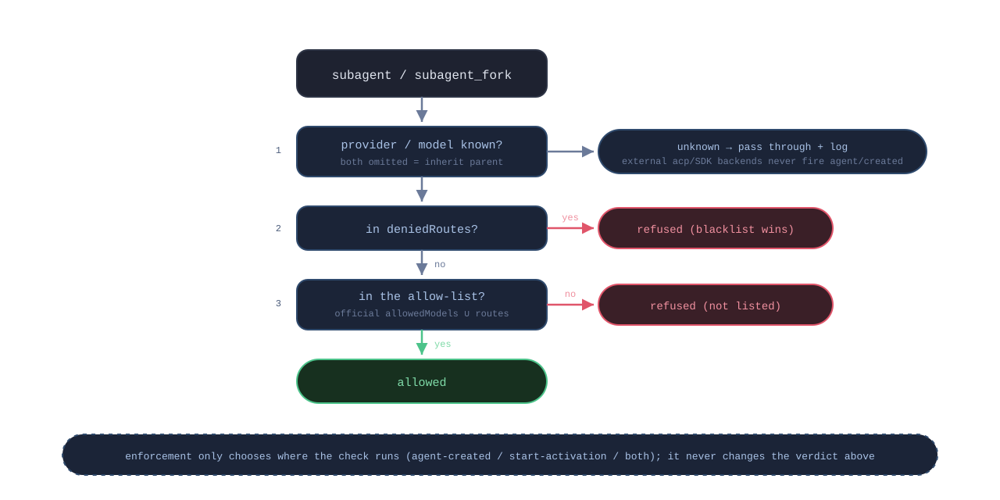
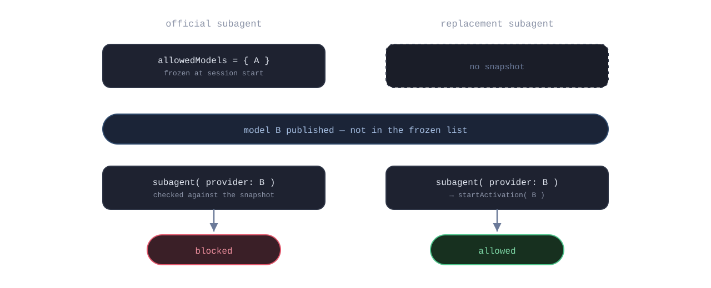

# Subagent Route Guard

The subagent route guard validates the `provider/model` a subagent will actually run on before dispatch, using allow-lists, a blacklist, and two optional checkpoints to control "who may delegate to whom".

> **Terminology (read this first)**
> - **Arguments** are passed by the agent on each dispatch and apply to that dispatch only, e.g. `provider`, `cwd`.
> - **Settings** are configured by you on the plugin page and persist across dispatches, e.g. `enforcement`, `replaceSubagentTool`.

## What problem it solves

DSH's official subagent allow-list (`subagent-model-selection-settings`'s `allowedModels`) is frozen into a snapshot when a session starts: a model published while a session is open cannot be used in that old session. This plugin solves exactly that, and adds an explicit "who may delegate to whom" policy — you decide which routes are allowed and which are explicitly denied. The official list is read live through `subagentModelSelection.current()` and recomputed on every check, so edits to the official allow-list and to this plugin's config take effect immediately, with no reload.

## What a dispatch passes through



The two right-hand exits differ: an unresolvable route passes through with a log entry, while a route on the official list simply passes. When the official list is empty or the service is unavailable the guard is inactive and no verdict is reached at all. `enforcement` only chooses where the check runs.

## The allow-list is the official one

This plugin keeps **no list of its own**. On every dispatch it reads the DSH
subagent model selection (`allowedModels`, via `subagentModelSelection.current()`),
so an edit in the DSH settings takes effect immediately without a reload.

That leaves exactly one place to decide who may be delegated to:

- **Non-empty official list** — only those routes may be dispatched; everything
  else is refused.
- **Empty list, official `enabled` off, or service unavailable** — no restriction
  is applied, matching DSH's native behaviour. The guard never invents a policy
  you did not configure.
- **To block a model** — remove it from the official list. This plugin has no
  blacklist and no wildcard.
## Choosing a checkpoint

`enforcement` is a setting (configured on the plugin page, persisting across dispatches) that decides where to validate; it defaults to `agent-created`:

- **`agent-created`**: validates at the `agent/created` event. Stable contract and covers `agent()` inside workflows; the cost is that a refusal leaves an empty session record behind.
- **`start-activation`**: wraps `ctx.subagents` and refuses before the agent is constructed — zero residue; the cost is a dependency on the internal `internal/get` hook.
- **`both`**: validates at both points, trading zero residue for double coverage.

Both gates are always registered and behave according to live `enforcement`; the fields are volatile, so a settings write needs no reload.

## The replacement tool



`replaceSubagentTool` is a setting (configured on the plugin page, persisting across dispatches, off by default); it replaces the official `subagent` tool with this plugin's own (a scoped shadow), letting subagents go straight to `startActivation` and bypass the snapshot frozen at session start — newly published models become usable immediately even in old sessions.

The cost is that it shadows only `subagent`: `subagent_fork` keeps the official tool and stays bound by the same session model snapshot. The replacement is registered into each agent scope at `agent/created`, with a catch-up pass for agents that already exist.

## Typical usage

The list lives in **DSH's own subagent model selection settings**; this plugin page does not offer it. Matching there is exact — there is no wildcard.

**Allow only some models** — list them in the official settings; this plugin follows immediately.

**Make a new model usable in old sessions immediately** (enable the replacement tool so it bypasses the snapshot frozen at session start):
```json
{
  "replaceSubagentTool": true
}
```

**Switch the guard off temporarily** (for diagnosis; everything passes):
```json
{
  "strict": false
}
```

## Self-check

`guard_selfcheck` is a read-only diagnostic tool with no parameters that changes nothing. It reports whether the guard is active (`active`), the strict flag and `enforcement` mode, what the official allow-list returned, the effective route count, the state of both gates and the replacement tool, the recent denial count, and a per-item `checks` array. **The settings page now ends with a 自检 card whose "运行自检" button hits the same read-only route and runs the same check**, so the button and the tool can never report differently; the route is not registered when the host has no web server, in which case the button reports that it cannot fetch the data.

**The 最近拒绝 table** below it lists each refusal: time, kind, parent route → child route, and the reason — it answers "why was that dispatch refused". It reads the in-memory denial log, capped by the 「保留最近拒绝数」 setting; when that is 0 the table says so instead of pretending everything is fine.

Its `officialAllowList` distinguishes three states to help answer "why was this route allowed/refused":

1. **Service unavailable**: `available:false` with an `error` (`subagentModelSelection` not mounted or missing `current()`);
2. **Official `enabled:false`**: `available:true, enabled:false`, an empty list, **no** `error` (a normal state — the official list imposes no restriction);
3. **Official enabled but empty** (`current()` throws): `available:true`, `error` set, an empty list.

Reach for it when a new model will not work, a route is unexpectedly allowed, or you want to confirm the guard is really in effect.

## How this differs from similar tools

More than one DSH plugin manages subagent models, but they aim at different things:

| Project | Mechanism | Difference |
|---|---|---|
| `ccsert/dsh-subagent-hub` | named presets plus a route-table guard that refuses out-of-bounds routes before dispatch; also reads the official `allowedModels` | positioned around grouping by preset; this plugin makes one verdict |
| `643048695/dsh-subagent-role-router` | **substitutes** an out-of-list model with an allowed one, and can switch models mid-run | this plugin **refuses and explains**, never substitutes silently |
| `CypherNaught-0x/DSH-Subagent-Model-Router` | picks the best model by capability tag | the opposite goal: it optimises, this one gates |
| `Funny1Potato/dsh-outsourcing-expert` | a preset that forces outsourcing, after scouting available models | prompt-level guidance, not runtime enforcement |

**The most concrete difference**: an optional replacement of the official `subagent` tool that goes straight to `ctx.subagents.startActivation()`, bypassing the model snapshot DSH freezes at session start. The projects above all work in the routing layer *before* that snapshot takes effect; none of them addresses "an old session has a frozen `subagent` tool schema, so a newly published model cannot be passed in at all".

Two further points are design choices rather than capabilities:

- **No list of its own.** The only source is the official `allowedModels`, read live on every dispatch, so an edit in the official settings takes effect immediately.
- **Refusals are recorded.** Parent route → child route plus the reason stay in memory and are shown in a table on the settings page, which is what answers "why was that dispatch refused".

## Known limitations

- External acp/SDK backends do not fire `agent/created` and expose no local provider/model; in that case the guard cannot determine the route and **allows and records** it (fail-open) rather than hard-refusing.
- Per-step auditing (`auditEveryStep`, default off) only writes logs and never blocks: reaching the model-call step means the creation-time check was bypassed, and refusing there would surface as "created successfully but fails immediately", so it only leaves a trace.
- The recent-denial records live only in process memory (`recentDenialLimit` defaults to 0) and are never persisted — a denial's reason contains a model name, which is private.
