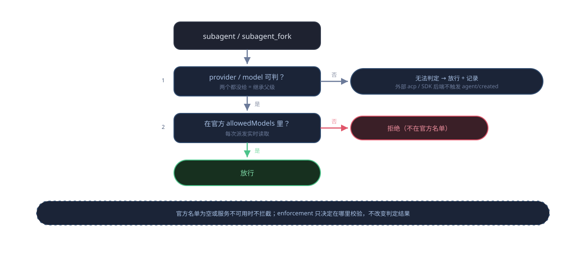
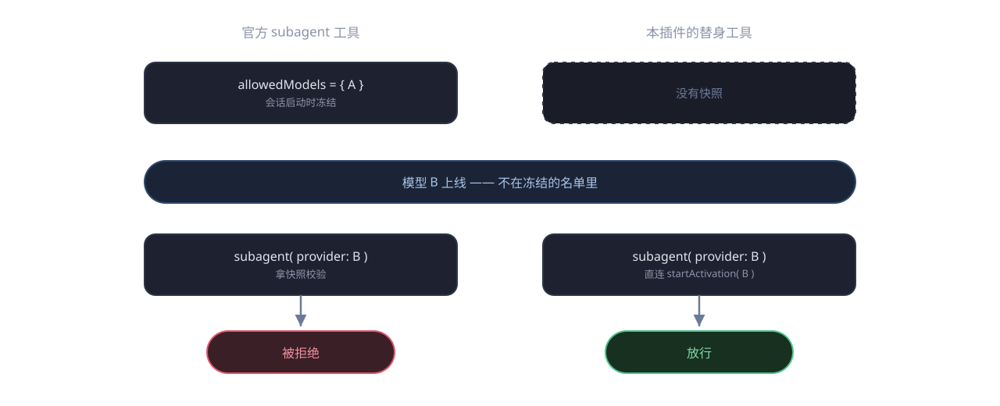

# 子智能体路由守卫

子智能体路由守卫在子智能体派发前校验它实际会运行的 `provider/model`，**放行依据完全来自 DSH 官方的子智能体白名单**，另配两个可选拦截点决定在哪里校验。

> **术语说明（请先读）**
> - **参数**：智能体每次派发子智能体时传入的值，只对本次派发生效，例如 `provider`、`cwd`。
> - **设置**：你在插件页配置、跨派发持续生效的值，例如 `enforcement`、`replaceSubagentTool`。

## 它解决什么问题

DSH 官方的子智能体白名单（`subagent-model-selection-settings` 的 `allowedModels`）在会话启动时被冻结成一份会话快照（会话启动时记下的模型选择策略）：会话开着的时候新上架的模型，在老会话里用不了。这个插件要解决的就是这件事，并额外提供一套「谁能派给谁」的显式策略——哪些路由允许、哪些显式拒绝，都由你说了算。官方名单通过 `subagentModelSelection.current()` 实时读取，每次校验都重算，所以官方白名单的改动和本插件配置的改动都能立刻生效，无需重载。

## 一次派发要过哪几道关



两条右侧出路要有区别：路由无法判定时是「放行 + 记录」（日志里留痕），命中官方名单时是直接放行。官方名单为空或服务不可用时守卫整体不生效，此时连判定都不发生。`enforcement` 只决定在哪里校验，不改变判定结果。

## 放行依据：只有官方白名单

本插件**不维护自己的名单**。每次派发时它实时读取 DSH 设置里「子智能体模型选择」的 `allowedModels`（经 `subagentModelSelection.current()`），在那里增删模型，这里立即跟随，无需重载。

因此「谁能派给谁」只有一个地方说了算：

- **官方列表非空** → 只有列表里的组合能派发，其余拒绝。
- **官方列表为空、官方 `enabled` 关闭、或服务不可用** → 不施加任何限制（与 DSH 原生行为一致）。守卫不会凭空发明一个你没配过的策略。
- **想封禁某个模型** → 去官方设置里把它从白名单删掉。本插件没有黑名单，也不提供通配符。

## 两个拦截点怎么选

`enforcement` 是一个设置（在插件页配置、跨派发持续生效），决定在哪儿校验，缺省为 `agent-created`：

- **`agent-created`**：在 `agent/created` 事件处校验。契约稳定、覆盖 workflow 里的 `agent()`；代价是被拒时会留下一个空的 session 记录。
- **`start-activation`**：包住 `ctx.subagents`，在 agent 构造之前拒绝，零残留；代价是依赖内部的 `internal/get` 钩子。
- **`both`**：两处都校验，用零残留换取双重保障。

两处闸门始终注册，由 `enforcement` 实时决定行为；改配置写的是 volatile 字段，不需要重载。

## 替身工具



`replaceSubagentTool` 是一个设置（在插件页配置、跨派发持续生效，缺省关闭），它用本插件自己的 `subagent` 工具取代官方工具，让子智能体直接走 `startActivation`，绕开会话快照——新上架的模型在老会话里也能立即可用。

代价是它只替换 `subagent` 这一个工具：`subagent_fork` 仍然使用官方工具，继续受同一份会话快照限制。替身工具在 `agent/created` 时注册到各个 agent scope；插件加载时还会对已存在的 agent 做一次补齐，会话运行中从设置页打开开关不会重复补齐。

## 另一个替身工具：`list_subagent_models`

官方的 `list_subagent_models` 读的是**会话快照**（`subagent/model-selection-policy` 事件，取第一条），不是当前设置。所以在会话中途往白名单里加模型之后，官方工具仍会回答「not allowed for this Session」——这个报错看起来像权限不足，实际是会话快照过期。

打开 `replaceListModelsTool` 后，这个工具改由本插件提供，数据源换成**当前官方设置**：

| 调用 | 本插件返回 |
|---|---|
| 无参数 | 白名单里出现过的 provider |
| `provider` | 该 provider 在白名单里的模型 |
| `provider` + `model` | 该模型与它的推理档位 |

输出格式与官方对齐，不改变调用方的习惯。它与 `replaceSubagentTool` 配套：一个负责「能不能派」，一个负责「有哪些可派」。

## 典型用法

名单在 **DSH 官方的「子智能体模型选择」设置里**配，本插件页不提供这一项。官方列表是精确匹配，没有通配符：
写 `"model": "*"` 只会命中一个名字真的叫 `*` 的模型。

**只允许某几个模型** —— 在官方设置里把它们列进白名单即可，本插件会自动跟随，无需在这里重复。

**新模型上线后老会话立刻可用**（开启替身工具，绕开会话快照）：
```json
{
  "replaceSubagentTool": true
}
```

**临时关掉守卫**（排查用；关掉后一切派发放行）：
```json
{
  "strict": false
}
```

## 自查

`guard_selfcheck` 是一个只读诊断工具，不改变任何状态；唯一的参数是可选的 `route`（`"provider/model"`），传了它就额外回答「这条路由现在会不会被放行、为什么」——不创建任何子智能体，所以可以把「派一次、被拒、读错误」换成「先问一句」。它返回：守卫是否生效（`active`）、严格模式与 `enforcement` 模式、官方白名单的读取结果、生效路由数、两道闸门与替身工具的安装情况、最近拒绝计数，以及逐项的 `checks`。**设置页底部的「自检」卡片也有一个「运行自检」按钮**，它走同一个只读路由、调用同一段检查逻辑，所以按钮和工具看到的结论不会不一致；该路由只读，插件在宿主没有 web server 时不会注册它（此时按钮会报取不到数据）。

**「最近拒绝」表格**（同一页下方）列出每条拒绝的时间、类型、父路由 → 子路由和原因，回答的是「刚才那次派发为什么被拒」。它读的是插件内存里的拒绝记录，条数由设置里的「保留最近拒绝数」决定；该项为 0 时表格会直接说明「没有记录」，而不是假装一切正常。

其中 `officialAllowList` 能区分三种状态，方便排查「为什么这个路由被放行/拒绝」：

1. **服务不可用**：`available:false`，并带 `error`（`subagentModelSelection` 未挂载或缺少 `current()`）；
2. **官方 `enabled:false`**：`available:true, enabled:false`，名单为空，**没有** `error`（这是正常状态，官方名单不施加限制）；
3. **官方 enabled 但列表为空**（`current()` 抛错）：`available:true`，`error` 有值，名单为空。

当新模型用不了、某个路由意外被放行、或想确认守卫是否真的生效时，用它看一眼最省事。

## 与同类的差异

DSH 生态里「管子智能体模型」的插件不止一个，但方向并不相同：

| 项目 | 机制 | 与我们的差别 |
|---|---|---|
| `ccsert/dsh-subagent-hub` | 具名预设 + 路由表守卫，派发前拒绝越界；也读官方 `allowedModels` | 定位更偏「按预设组队」，我们只做单一判定 |
| `643048695/dsh-subagent-role-router` | 白名单外的模型**替换成允许的**，并支持运行中换模型 | 我们**拒绝并说明原因**，不做静默替换 |
| `CypherNaught-0x/DSH-Subagent-Model-Router` | 按能力标签自动选优 | 目的相反：它选优，我们守门 |
| `Funny1Potato/dsh-outsourcing-expert` | preset 层面强制外包，并先侦察可用模型 | 提示层引导，不是运行时强制 |

**最实在的一条差异**：可选地替换官方 `subagent` 工具，直接走 `ctx.subagents.startActivation()`，绕开 DSH 在会话启动时冻结的模型快照。上面这些项目都在「快照生效之前」的路由层做文章，没有正面处理「旧会话里 `subagent` 的工具 schema 已经冻结、新上架的模型根本传不进去」这个限制。

另外两条是设计取向，不是能力差异：

- **不维护自己的名单**：放行依据只有 DSH 官方设置里的 `allowedModels`，每次派发实时读取，因此官方那边改了模型立刻生效。
- **拒绝留痕**：把「父路由 → 子路由 + 原因」记在内存里，并展示在设置页的表格中，方便回答「刚才那次为什么被拒」。

## 已知限制

- 外部 acp/SDK 后端不触发 `agent/created`，而且不暴露本地的 provider/model；这种情况下守卫无法确定路由，选择**放行并记录**（fail-open），不会硬拒。
- 每步审计（`auditEveryStep`，默认关闭）只写日志、不拦截：走到模型调用这一步说明创建阶段的校验已漏网，此时拒绝会变成「创建成功但立刻失败」，所以只留痕。
- 最近拒绝记录只存在于进程内存（`recentDenialLimit` 默认 0），绝不落盘——拒绝原因含模型名，属于隐私。
